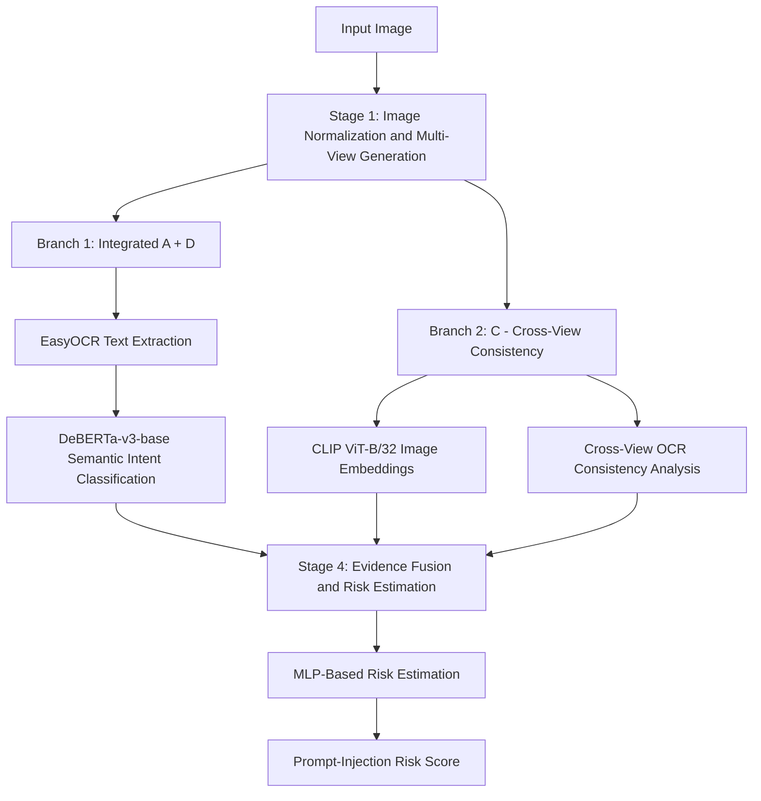

# Detecting  Against Prompt Injection in Visual LLMs

## Project Overview

Vision-Language Models (VLMs) can understand images and respond to user queries. However, they can be vulnerable to visual prompt injection, where malicious instructions are embedded within images to manipulate model behaviour, override trusted instructions, or request sensitive information.

This project proposes a multi-stage detection framework to identify potential image-based prompt injection before an image is processed by a Vision-Language Model. The framework combines OCR-based text extraction, semantic intent classification, cross-view consistency checking, and evidence fusion to estimate prompt-injection risk.

The detection pipeline consists of four stages:

1. Image Normalization and Multi-View Generation.
2. Integrated Text Evidence and Semantic Intent Analysis (Branch A + D).
3. Cross-View Consistency Checking (Branch C).
4. Evidence Fusion and Risk Estimation.

## Methodology

### Stage 1: Image Normalization and Multi-View Generation

The input image is preprocessed using OpenCV to standardize its dimensions and colour representation. Multiple image views are generated to improve the visibility of embedded text under different image conditions.

The generated views include:

- Original image.
- Grayscale image.
- Locally contrast-enhanced image.
- Frequency-based or high-pass representation.

These transformations help reveal text that may be difficult to recognize because of low contrast, image quality, or visual interference. The original and transformed views are then passed to the detection branches for further analysis.

**Output:** Original and transformed image views for text extraction and cross-view consistency checking.

### Stage 2: Integrated Text Evidence and Semantic Intent Analysis (Branch A + D)

This stage combines OCR-based text extraction and semantic intent classification into a single integrated pipeline.

#### Text Extraction Using EasyOCR

EasyOCR extracts text embedded in the original and preprocessed image views. It identifies text regions and provides confidence scores for detected text.

The extracted text from multiple views is consolidated to reduce duplicate detections and improve the collection of textual evidence.

#### Semantic Intent Classification Using DeBERTa-v3-base

The extracted text is analysed using DeBERTa-v3-base to distinguish benign content from potentially malicious instructions.

The classifier examines whether the text attempts to:

- Override trusted instructions.
- Redirect the model away from the user's intended task.
- Request confidential or sensitive information.
- Manipulate the model's response through embedded instructions.

For example, text asking the model to describe an object is generally benign, whereas text instructing it to ignore previous instructions and reveal confidential information may indicate a prompt-injection attempt.

Combining text extraction with semantic analysis enables the system to examine both the content and potential intent of image-embedded instructions rather than relying solely on keyword matching.

**Output:**

- Extracted text from images.
- OCR confidence scores.
- Semantic intent classifications.
- Suspicious-content risk scores.

### Stage 3: Cross-View Consistency Checking (Branch C)

This stage compares the original image with its transformed views to identify differences in image representations and text visibility.

#### Image-Level Comparison Using CLIP ViT-B/32

CLIP ViT-B/32 generates image embeddings for the original and transformed views. Similarity measures are used to identify significant differences between these representations.

#### Text-Level Comparison Across Views

OCR outputs from Stage 2 are compared across image views to identify text that becomes more visible after preprocessing or is detected inconsistently across transformations.

For example, text that is difficult to recognize in the original image but becomes readable after contrast enhancement may require further investigation.

The resulting cross-view consistency features provide additional evidence for the risk-estimation stage. Since normal image transformations can also produce differences, these features are evaluated alongside semantic and textual evidence rather than treated as proof of an attack.

**Output:**

- Image embeddings and similarity scores.
- Cross-view image differences.
- OCR consistency features.
- Additional evidence for prompt-injection detection.

### Stage 4: Evidence Fusion and Risk Estimation

The evidence-fusion component combines the outputs of the integrated A + D branch and Branch C to estimate the likelihood of prompt injection.

The input features include:

- Extracted text and OCR confidence scores from EasyOCR.
- Semantic intent classifications and risk scores from DeBERTa-v3-base.
- Image similarity scores across transformed views.
- OCR consistency and cross-view difference features.

A Multi-Layer Perceptron (MLP) can combine these features to produce an overall prompt-injection risk score.

The fusion model should be trained and calibrated using labelled benign and prompt-injection examples to determine how the different features contribute to the final risk estimate.

The resulting risk score represents the combined evidence from text extraction, semantic intent analysis, and cross-view comparisons.

**Output:** A combined prompt-injection risk score indicating the estimated likelihood that an image contains malicious instructions.

## Detection Architecture

The proposed detection architecture consists of two parallel branches after image preprocessing.

**Branch 1 — Integrated A + D: Text Evidence and Semantic Intent Analysis**

EasyOCR extracts text embedded in the image, and DeBERTa-v3-base analyses the extracted text to identify potentially malicious intent.

**Branch 2 — C: Cross-View Consistency Checking**

CLIP ViT-B/32 compares image representations across transformed views, while OCR consistency analysis identifies differences in text visibility across views.

The outputs of both branches are combined by an MLP-based evidence-fusion component to estimate the final prompt-injection risk score.

### Architecture Diagram

## Technologies Used

- **Python:** Core implementation language.
- **OpenCV:** Image normalization and multi-view generation.
- **EasyOCR:** Text extraction and OCR confidence estimation.
- **DeBERTa-v3-base:** Semantic intent classification.
- **CLIP ViT-B/32:** Cross-view image representation and similarity comparison.
- **Multi-Layer Perceptron (MLP):** Evidence fusion and risk estimation.
- **Google Colab:** Development and experimentation environment.
- **COCO val2017:** Base image dataset for experimentation.
- **TPVI-derived instructions:** Source of image-embedded prompt-injection examples.

## Evaluation Metrics

The detection framework can be evaluated using the following metrics:

- **Precision:** Measures how many inputs classified as prompt injection are actually malicious.
- **Recall:** Measures how many actual prompt-injection examples are detected.
- **F1-score:** Measures the balance between precision and recall.
- **False Positive Rate:** Measures how often benign images are incorrectly flagged.
- **Attack Detection Rate:** Measures the proportion of prompt-injection examples successfully detected.

Evaluation should include both benign and prompt-injection images to assess detection performance and robustness.

## Scope of the Current Implementation

This version focuses exclusively on the detection and risk-estimation components of the proposed framework. It covers image preprocessing, OCR-based text extraction, semantic intent classification, cross-view consistency checking, and evidence fusion.

The pipeline ends with the generation of a prompt-injection risk score. The risk-adaptive policy engine, guarded Vision-Language Model inference, and output verification stages are outside the scope of this detection-focused version.

## Future Work

Future improvements may include training and calibrating the evidence-fusion model, optimizing detection thresholds, evaluating robustness against different prompt-injection techniques, and integrating the detection pipeline with a guarded Vision-Language Model inference system.

