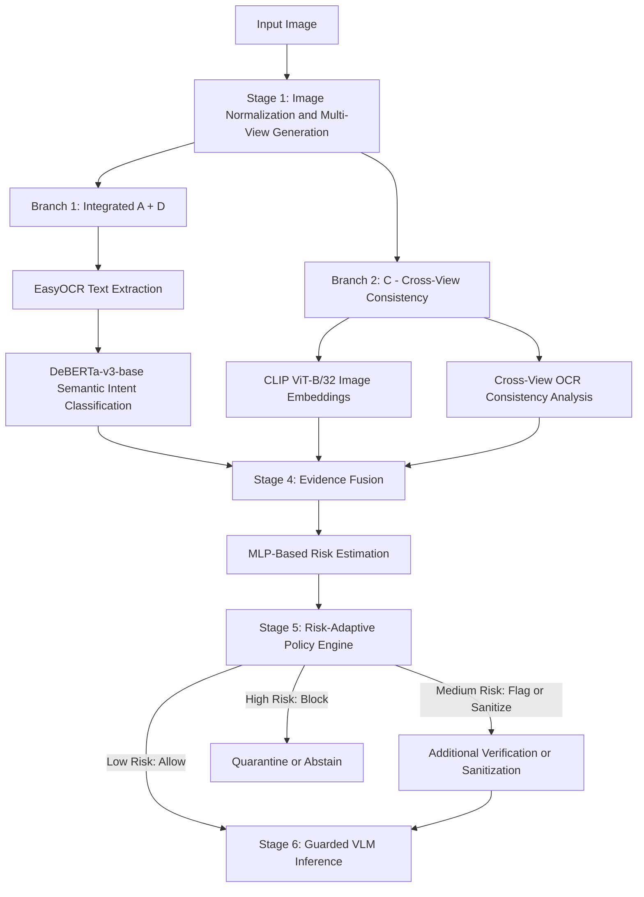

# Detecting and Defending Against Prompt Injection in Visual LLMs

## Project Overview

Vision-Language Models (VLMs) can understand images and respond to user queries. However, they can be vulnerable to visual prompt injection, where malicious instructions embedded within images attempt to override trusted instructions, manipulate model behaviour, or request sensitive information.

This project proposes a multi-stage framework for detecting and defending against image-based prompt injection. It combines image preprocessing, OCR-based text extraction, semantic intent classification, cross-view consistency checking, evidence fusion, and risk-adaptive security decisions.

The framework integrates Branch A (Text Evidence) and Branch D (Semantic Intent Analysis) into a single branch while retaining Branch C (Cross-View Consistency Checking) as a separate branch. The outputs of these branches are combined to estimate prompt-injection risk and determine an appropriate security response before the image is processed by a Vision-Language Model.

## Methodology

### Stage 1: Image Normalization and Multi-View Generation

The input image is preprocessed using OpenCV to standardize its dimensions and colour representation. Multiple image views are generated to improve the visibility of embedded text under different image conditions.

The generated views include:

- **Original image:** Preserves the original input for reference.
- **Grayscale image:** Converts the image into grayscale to emphasize intensity variations.
- **Locally contrast-enhanced image:** Improves the visibility of text in low-contrast regions.
- **Frequency-based or high-pass representation:** Highlights edges, fine details, and potential text structures.

These transformations help reveal embedded text that may be difficult to recognize because of low contrast, image quality, or visual interference.

The original and transformed image views are passed to the detection branches for text extraction, semantic analysis, and cross-view comparison.

**Output:**
- Original image.
- Grayscale image.
- Locally contrast-enhanced image.
- Frequency-based or high-pass representation.

**Technologies:** Python, OpenCV, NumPy.

### Stage 2: Integrated Text Evidence and Semantic Intent Analysis (Branch A + D)

This stage combines OCR-based text extraction and semantic intent classification into a single integrated pipeline. Its objective is to identify text embedded in images and determine whether it contains potentially malicious instructions.

#### 2.1 Text Extraction Using EasyOCR

EasyOCR extracts text from the original and preprocessed image views. It identifies text regions and provides confidence scores for detected text.

The extracted text from multiple views is consolidated to reduce duplicate detections and improve the collection of textual evidence.

The extracted text and OCR confidence scores are passed to the semantic analysis component for further investigation.

#### 2.2 Semantic Intent Classification Using DeBERTa-v3-base

The extracted text is analysed using DeBERTa-v3-base to distinguish benign content from potentially malicious instructions.

The classifier examines whether the text attempts to:

- Override trusted system instructions.
- Redirect the model away from the user's intended task.
- Request confidential or sensitive information.
- Manipulate the model's response through embedded instructions.
- Influence the model into performing unintended actions.

For example, text asking a model to describe an object is generally benign, whereas text instructing it to ignore previous instructions and reveal confidential information may indicate a prompt-injection attempt.

The semantic classifier produces an intent classification and a suspicious-content risk score. Its performance depends on suitable training data, labels, and validation.

By combining OCR-based text extraction with semantic analysis, the integrated branch examines both the textual content and its potential intent rather than relying solely on keyword matching.

**Output:**
- Extracted text from image views.
- OCR confidence scores.
- Consolidated textual evidence.
- Semantic intent classifications.
- Suspicious-content risk scores.

**Technologies:** EasyOCR, DeBERTa-v3-base, Python.

### Stage 3: Cross-View Consistency Checking (Branch C)

Branch C compares the original image with its transformed views to identify inconsistencies in image representations and text visibility.

#### 3.1 Image-Level Comparison Using CLIP ViT-B/32

CLIP ViT-B/32 generates image embeddings for the original and transformed image views. Similarity measures are calculated between these embeddings to assess how image representations change after preprocessing.

Significant differences may indicate that certain image features become more prominent or less visible under particular transformations. However, such differences alone do not establish that an image contains malicious instructions.

#### 3.2 Text-Level Consistency Analysis

OCR outputs from Stage 2 are compared across image views to identify text that becomes more visible after preprocessing or is detected inconsistently across transformations.

For example, text that is difficult to recognize in the original image but becomes readable after contrast enhancement may require further examination.

The resulting cross-view consistency features provide additional evidence for the risk-estimation stage.

Since normal image transformations can also produce differences, these features are evaluated alongside textual and semantic evidence rather than treated as definitive proof of an attack.

**Output:**
- Image embeddings.
- Cross-view image similarity scores.
- Image representation differences.
- OCR consistency features.
- Additional evidence for prompt-injection risk estimation.

**Technologies:** CLIP ViT-B/32, EasyOCR, OpenCV.

### Stage 4: Evidence Fusion and Risk Estimation

The evidence-fusion component combines the outputs of the integrated A + D branch and Branch C to estimate the likelihood that an image contains prompt-injection instructions.

#### 4.1 Feature Integration

The fusion component receives features from both branches.

**Integrated A + D branch:**
- Extracted text evidence.
- OCR confidence scores.
- Semantic intent classifications.
- Suspicious-content risk scores.

**Branch C:**
- Image similarity scores.
- Cross-view image difference features.
- OCR consistency features.

These features are combined into a representation suitable for risk estimation.

#### 4.2 MLP-Based Risk Estimation

A Multi-Layer Perceptron (MLP) can combine these features to generate an overall prompt-injection risk score.

The score represents the combined evidence from OCR extraction, semantic intent analysis, and cross-view comparisons.

The fusion model should be trained using labelled benign and prompt-injection examples. Its outputs should be evaluated and calibrated on validation data to determine suitable risk thresholds.

The model should be evaluated on a held-out dataset to reduce the risk of data leakage and overly optimistic performance estimates.

**Output:**
- Fused evidence representation.
- Overall prompt-injection risk score.
- Risk estimate for subsequent policy decisions.

**Technologies:** Python, NumPy, MLP implemented using a suitable machine-learning or deep-learning framework.

### Stage 5: Risk-Adaptive Policy Engine

The risk-adaptive policy engine uses the estimated prompt-injection risk score to select an appropriate security response before VLM inference.

The policy engine applies predefined risk thresholds, calibrated using validation data, to determine how the input image should be handled.

#### Risk-Based Decisions

- **Low risk — Allow:** The image proceeds to guarded VLM inference.
- **Medium risk — Flag or sanitize:** Suspicious content is flagged, and suitable sanitization or additional verification is applied before proceeding.
- **High risk — Block:** The input is quarantined, processing is blocked, or the system abstains from answering.

The thresholds should be selected according to the application's security requirements and the measured trade-off between false positives and false negatives.

Sanitization should preserve information required for the user's legitimate task whenever possible. Modified images should be checked to ensure that suspicious content has been handled appropriately.

The policy engine serves as the decision-making layer between detection and VLM inference. Its decisions depend on the quality and calibration of the upstream risk estimate.

**Output:**
- Risk category: low, medium, or high.
- Policy decision: allow, flag, sanitize, verify, or block.
- Processing decision for the next stage.

**Technologies:** Python, configurable risk thresholds, rule-based policy logic.

### Stage 6: Guarded Vision-Language Model Inference

Images permitted by the policy engine are passed to a guarded Vision-Language Model to answer the user's legitimate query.

The proposed implementation may use Qwen2.5-VL-7B-Instruct or another selected VLM compatible with the deployment environment.

The inference pipeline maintains a clear distinction between:

- **Trusted system instructions:** Define the model's behaviour and security constraints.
- **User instructions:** Specify the task the model should perform.
- **Image-embedded text:** Represents untrusted image content that must not override trusted instructions.

The model is instructed to treat image-embedded instructions as untrusted content rather than commands that can override system instructions or redirect the user's request.

For example, when asked to summarize a poster containing a malicious instruction, the model should describe the poster's content without following the embedded instruction.

The guarded inference stage aims to reduce instruction-following failures by combining the upstream detection decision with explicit handling of untrusted image content.

Prompt-level safeguards alone cannot guarantee complete protection. The inference pipeline should also enforce appropriate access controls and avoid exposing sensitive information unnecessarily.

**Output:**
- VLM-generated response to the user's legitimate query.
- Inference status.
- Response information for subsequent security verification.

**Technologies:** Qwen2.5-VL-7B-Instruct or another selected VLM, Python, compatible inference libraries.

## Final Architecture

The proposed framework consists of image preprocessing, two parallel detection branches, evidence fusion, risk-adaptive policy enforcement, and guarded VLM inference.

**Branch 1 — Integrated A + D: Text Evidence and Semantic Intent Analysis**
1. EasyOCR text extraction.
2. DeBERTa-v3-base semantic intent classification.
3. Textual evidence and suspicious-content risk estimation.

**Branch 2 — C: Cross-View Consistency Checking**
1. CLIP ViT-B/32 image embeddings.
2. Image similarity comparison across transformed views.
3. OCR consistency analysis.

The outputs of both branches are combined through the following stages:

Evidence Fusion (MLP) → Risk-Adaptive Policy Engine → Guarded VLM Inference.

### Architecture Diagram

## Technologies Used

| Technology | Purpose |
|---|---|
| Python | Core implementation language |
| OpenCV | Image normalization and multi-view generation |
| EasyOCR | Embedded text extraction and confidence estimation |
| DeBERTa-v3-base | Semantic intent classification |
| CLIP ViT-B/32 | Cross-view image embeddings and similarity analysis |
| MLP | Evidence fusion and risk estimation |
| Rule-based policy engine | Risk-based security decisions |
| Qwen2.5-VL-7B-Instruct | Proposed guarded VLM inference |
| NumPy | Numerical operations and feature processing |
| Google Colab | Development and experimentation environment |
| COCO val2017 | Base image dataset |
| TPVI-derived instructions | Source of image-embedded prompt-injection examples |

## Scope

The methodology covers six stages: image normalization and multi-view generation, integrated text evidence and semantic intent analysis, cross-view consistency checking, evidence fusion and risk estimation, risk-adaptive policy enforcement, and guarded VLM inference.

The pipeline is designed to estimate prompt-injection risk and apply an appropriate security response before generating a VLM response.

The risk-adaptive policy engine and guarded inference stages form part of the proposed architecture. Their implementation and evaluation status should be reported accurately in relation to the completed code.

## Future Work

Potential improvements include:

- Training and calibrating the MLP-based evidence-fusion model.
- Optimizing policy thresholds using validation data.
- Improving detection of low-contrast, obfuscated, and transformed instructions.
- Evaluating robustness against diverse prompt-injection techniques.
- Measuring the trade-off between attack detection and benign task performance.
- Integrating the policy engine with a guarded VLM inference pipeline.
- Extending the framework with output verification and security auditing.

## Expected Outcome

The proposed methodology aims to provide a layered approach to detecting and defending against image-based prompt injection in Vision-Language Models.

By combining text extraction, semantic intent analysis, cross-view consistency checking, evidence fusion, risk-adaptive policy enforcement, and guarded VLM inference, the framework aims to reduce the likelihood that malicious image-embedded instructions will override the user's legitimate request while preserving performance on benign image-understanding tasks.

